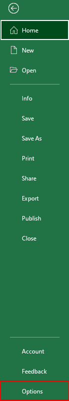
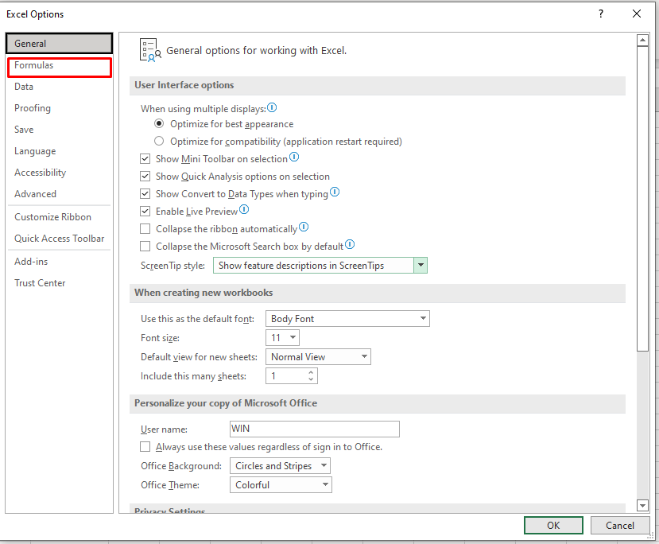
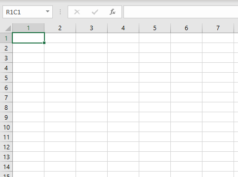

# Performing data calculations using formulas in Excel 365

## The exercise

To complete the exercise successfully, you will need to do the following tasks:

1. Perform simple calculations to create automated running totals.
   - Open the **Cost** worksheet.
   - Calculate the total number of units sold in January and February.
   - Calculate the difference between the number of units sold in April and May.
   - Calculate the total income earned in March.
   - Calculate the average number of units sold in January and February.
   - Find the automated running total of units sold by using a reference cell value.

2. Count cells in a range.
   - Open the **Order History** worksheet.
   - Find the number of orders from New York using the `COUNT()` function.
   - Find the number of products not ordered from Chicago using the `COUNTBLANK()` function.
   - Find the number of products from California with an order value of "14" using the `COUNTIF()` function.

3. Work with built-in functions to perform data calculations.
   - Open the **Shipping** worksheet.
   - Calculate the gift amount for Kivell using the `IFS()` function.
   - Find the delivery day of the order for Kivell using the `SWITCH()` function.
   - Find the maximum cost with the shipping time value as "1" using the `MAXIFS()` function.
   - Calculate the average shipping cost using the `AVERAGEIFS()` function.
   - Calculate the expenses incurred in a day for Kivell's order using the `QUOTIENT()` function.
   - Calculate the balance expenses incurred in a day for Kivell's order using the `MOD()` function.

4. Configure the default formula options.
   - Open a new worksheet.
   - Activate the R1C1 reference style using the **Excel Options** window.
   - Deactivate the Formula AutoComplete feature using the **Excel Options** window.

## Process for completing the exercise

### Perform simple calculations to create automated running totals

1. Open the workbook.

2. Select the **Cost** worksheet. Observe the data on the worksheet.

3. Select cell **B8**.

4. To find the sum of units sold in January and February, in the formula bar, type `=C2+C3`, and press **Enter**. The result is displayed in cell **B8**.

   

5. Select cell **B10**.

6. To find the difference between the number of units sold in April and May, in the formula bar, type `=C5-C6`, and press **Enter**. The result is displayed in cell **B10**.

   

7. Select the cell **D8**.

8. To find the total income earned in March, in the formula bar, type `=B4*C4`, and press **Enter**. The result is displayed in cell **D8**.

   

9. Select the cell **D10**.

10. To find the average number of units sold in January and February, in the formula bar, type `=B8/2` and press **Enter**. The result is displayed in cell **D10**.

    

11. Select cell **D2**.

12. To find the automated running total of units sold by using a reference cell value, in the formula bar, type `=SUM(C2, C3)` and press **Enter**. The result is displayed in cell **D2**.

    ![The Cost worksheet is open and is partially shown. The Name Box and the formula bar are shown. The formula to calculate the automated running total of units sold by using a reference cell value is shown in the formula bar and is highlighted in red. Column A displays the months, column B displays the cost per product, column C displays the number of units sold, and column D displays the automated running total of units sold. The result of the formula is shown in the cell D2 and is highlighted in red.](images/05-cost-running-total-formula.png)

13. To find the automated running totals of units sold from January to May, select cell **D2**. A black fill handle is displayed at the bottom right corner of the cell.

14. To get the result, drag the fill handle downwards from cells **D3** to **D6**. The cells from **D3** to **D6** are filled automatically with the running totals.

    ![The Cost worksheet is open and is partially shown. The Name Box and the formula bar are shown. The formula to calculate the automated running total of units sold by using a reference cell value is shown in the formula bar. Column A displays the months, column B displays the cost per product, column C displays the number of units sold, and column D displays the automated running total of units sold. The cell D2 is selected. A black fill handle is displayed at the bottom right corner of the selected cell. The fill handle is dragged down from cells D3 to D6 to calculate the automated running totals of units sold from January to May. The cells D3 to D6 are highlighted in red.](images/06-cost-fill-handle.png)

### Count cells in a range

1. Select the **Order History** worksheet. Observe the data on the worksheet.

2. Select cell **B14**.

3. To find the number of orders from New York, in the formula bar, type `=COUNT(C2:C11)` and press **Enter**. The result is displayed in cell **B14**.

   

4. Select cell **B15**.

5. To find the number of products not ordered from Chicago, in the formula bar, type `=COUNTBLANK(D2:D11)` and press **Enter**. The result is displayed in cell **B15**.

   ![The Order History worksheet is open and is partially shown. The Name Box and the formula bar are shown. The formula to calculate the number of products not ordered from Chicago is shown in the formula bar and is highlighted in red. Column A displays the products, column B displays the units, column C displays the orders from New York, and column D displays the orders from Chicago. The result of the formula is shown in the cell B15 and is highlighted in red. The number of orders from New York is shown in the cell B14.](images/08-orders-countblank-chicago.png)

6. Select cell **B16**.

7. To find the number of products from California with an order value of "14", in the formula bar, type `=COUNTIF(E2:E11,"=14")` and press **Enter**. The result is displayed in cell **B16**.

   ![The Order History worksheet is open and is partially shown. The Name Box and the formula bar are shown. The formula to calculate the number of products from California with an order value of “14” is shown in the formula bar and is highlighted in red. Column A displays the products, column B displays the units, column C displays the orders from New York, column D displays the orders from Chicago, and column E displays the orders from California. The result of the formula is shown in the cell B16 and is highlighted in red. The number of orders from New York and the number of products not ordered from Chicago are shown in the cells B14 and B15, respectively.](images/09-orders-countif-california.png)

### Work with built-in functions to perform data calculations

1. Select the **Shipping** worksheet. Observe the data on the worksheet.

2. Select cell **F2**.

3. To calculate the gift amount for Kivell, in the formula bar, type `=IFS(C2>850,"25",C2>650,"20",C2>450,"15",C2>250,"10",TRUE,"F")` and press **Enter**. The result is displayed in cell **F2**.

   The gift amount for each Order ID is calculated as follows:

   | Total Cost | Gift Amount |
   | --- | --- |
   | >850 | 25 |
   | >650 | 20 |
   | >450 | 15 |
   | >250 | 10 |

   ![The Shipping worksheet is open and is partially shown. The Name Box and the formula bar are shown. The formula to calculate the gift amount for Kivell is shown in the formula bar and is highlighted in red. Column A displays the order ID, column B displays the name of the person, column C displays the total cost in dollars, column D displays the shipping cost in dollars, column E displays the shipping time in days, and column F displays the gift amount in dollars. Row 2 displays the data of Kivell. The result of the formula is shown in the cell F2 and is highlighted in red.](images/10-shipping-ifs-gift-amount.png)

4. Select cell **G2**.

5. To find the delivery day of the order for Kivell, in the formula bar, type `=SWITCH(E2,1,"Next Day",0,"Same Day","No match")` and press **Enter**. The result is displayed in cell **G2**.

   The delivery day of an order is calculated as follows:

   | Shipping Time | Delivery Day |
   | --- | --- |
   | 0 | Same Day |
   | 1 | Next Day |

   ![The Shipping worksheet is open and is partially shown. The Name Box and the formula bar are shown. The formula to calculate the delivery day of the orders is shown in the formula bar and is highlighted in red. Column A displays the order ID, column B displays the name of the person, column C displays the total cost in dollars, column D displays the shipping cost in dollars, column E displays the shipping time in days, column F displays the gift amount in dollars, and column G displays the delivery day. Row 2 displays the data of Kivell. The result of the formula is shown in the cell G2 and is highlighted in red.](images/11-shipping-switch-delivery-day.png)

6. Select cell **E17**.

7. To find the average shipping cost, in the formula bar, type `=AVERAGEIFS(D2:D15, D2:D15, ">0", D2:D15, "<5")` and press **Enter**. The result is displayed in cell **E17**.

   

8. Select cell **B17**.

9. To find the maximum cost with the shipping time value considered as "1", in the formula bar, type `=MAXIFS(C2:C15,E2:E15,1)` and press **Enter**. The result is displayed in cell **B17**.

   ![The Shipping worksheet is open and is partially shown. The Name Box and the formula bar are shown. The formula to calculate the maximum cost with the shipping time value considered as “1” is shown in the formula bar and is highlighted in red. Column A displays the order ID, column B displays the name of the person, column C displays the total cost in dollars, column D displays the shipping cost in dollars, and column E displays the shipping time in days. The result of the formula is shown in the cell B17 and is highlighted in red.](images/13-shipping-maxifs.png)

10. Select the cell **H2**.

11. To find the expenses incurred in a day for Kivell's order, in the formula bar, type `=QUOTIENT(C2+D2,30)` and press **Enter**. The result is displayed in the cell **H2**.

    ![The Shipping worksheet is open and is partially shown. The Name Box and the formula bar are shown. The formula to calculate the expenses incurred in a day for Kivell’s order is shown in the formula bar and is highlighted in red. Column A displays the order ID, column B displays the name of the person, column C displays the total cost in dollars, column D displays the shipping cost in dollars, column E displays the shipping time in days, column F displays the gift amount in dollars, column G displays the delivery day, and column H displays the expense for a day in dollars. Row 2 displays the data of Kivell. The result of the formula is shown in the cell H2 and is highlighted in red.](images/14-shipping-quotient.png)

12. Select the cell **I2**.

13. To calculate the balance expenses incurred in a day for Kivell's order, in the formula bar, type `=MOD(C2+D2,30)` and press **Enter**. The result is displayed in cell **I2**.

    ![The Shipping worksheet is open and is partially shown. The Name Box and the formula bar are shown. The formula to calculate the balance expenses incurred for Kivell’s order is shown in the formula bar and is highlighted in red. Column A displays the order ID, column B displays the name of the person, column C displays the total cost in dollars, column D displays the shipping cost in dollars, column E displays the shipping time in days, column F displays the gift amount in dollars, column G displays the delivery day, column H displays the expense for a day in dollars, and column I displays the balance expense for a day in dollars. Row 2 displays the data of Kivell. The result of the formula is shown in the cell I2 and is highlighted in red.](images/15-shipping-mod.png)

### Configure the default formula options

1. To open a new blank worksheet, on the sheet tab at the bottom of the workbook, click the **(+)** sign.

2. A new blank worksheet, **Sheet1**, opens.

3. Click the **File** tab and click **Options**.

   

4. The **Excel Options** window appears.

5. On the left pane, click **Formulas**.

   

6. On the right pane, under **Working with formulas**, click the **R1C1 reference style** checkbox and click **OK**.

   

7. On the worksheet, cell **A1** is selected by default.

8. In the **Name Box**, observe the **R1C1** reference style of referencing the cell **A1**. The columns are numbered instead of alphabets.

   

9. To get the list of possible formulas provided by the **Formula Autocomplete** feature, click the cell **R1C1** and type `=AV`.

   

10. Click the **File** tab and click **Options**.

    

11. The **Excel Options** window appears.

12. On the left pane, click **Formulas**.

    

13. On the right pane, under **Working with formulas**, click to clear the **Formula AutoComplete** and **R1C1 reference style** checkboxes and click **OK**.

    ![The Excel Options window is shown. On the left pane, General, Formulas, Data, Proofing, Save, Language, Accessibility, Advanced, Customize Ribbon, Quick Access Toolbar, Add-ins, and Trust Center tabs are shown. On the right pane, options related to the Formulas tab such as Calculation options, Working with formulas, Error Checking, and Error checking rules are displayed. Under Working with formulas, the Formula AutoComplete checkbox and R1C1 reference style checkboxes are cleared and are highlighted in red. OK is highlighted in red.](images/21-options-clear-autocomplete.png)

14. Observe cell **A1**. The formula is not displayed automatically, and there is an error.

    
